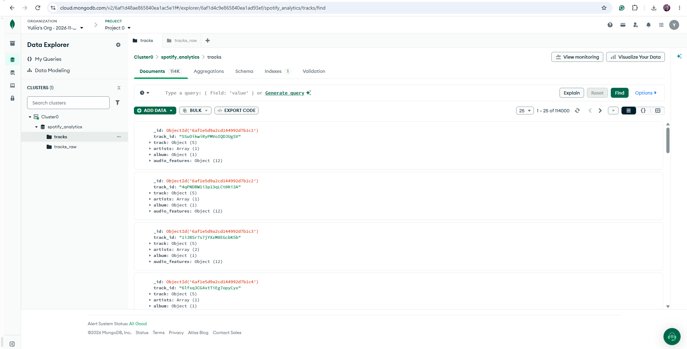
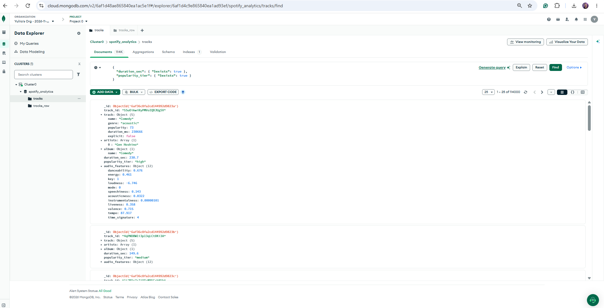
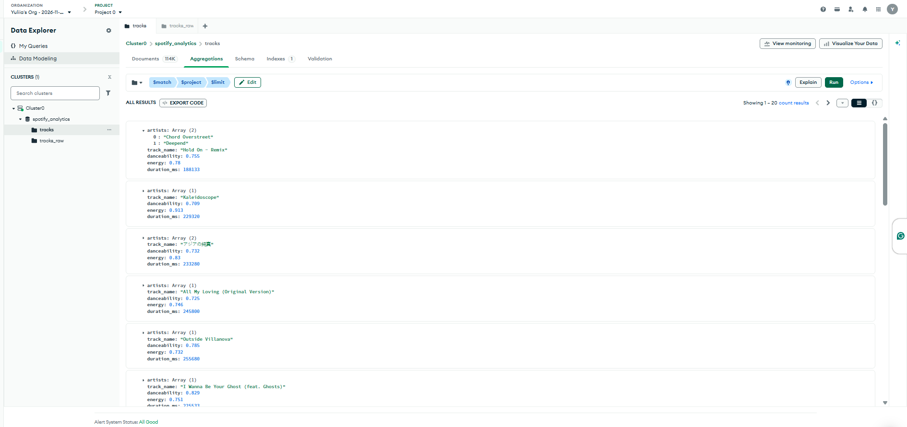
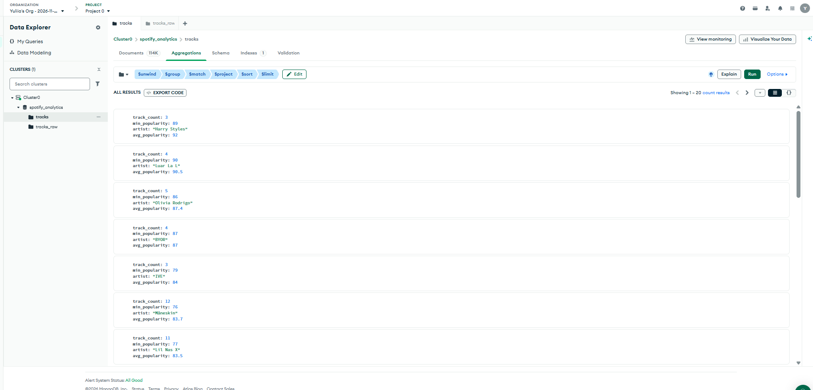
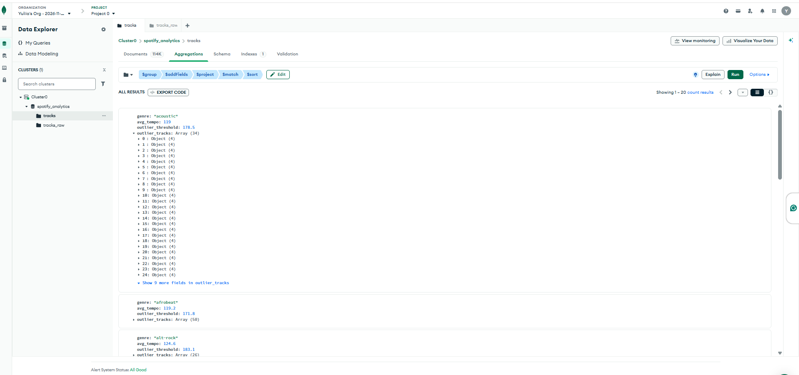
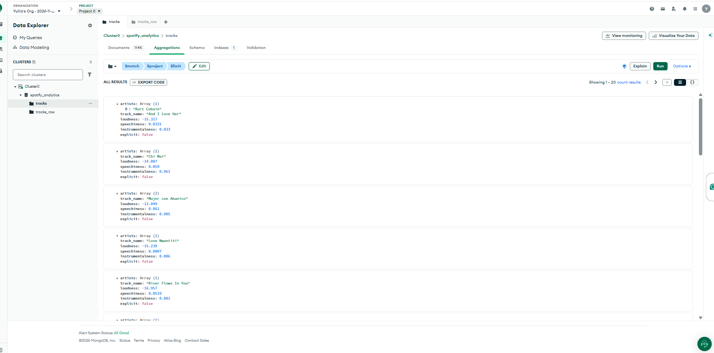

# Spotify Analytics - MongoDB

## Опис проєкту

У цьому проєкті я працювала з датасетом Spotify та аналізувала музичні треки за допомогою MongoDB.

Я завантажила дані з CSV-файлу в MongoDB Atlas, перетворила їх на вкладені документи та виконала запити для пошуку й аналізу музики.

Для роботи використала датасет [Spotify Tracks Dataset з Kaggle](https://www.kaggle.com/datasets/maharshipandya/-spotify-tracks-dataset), який містить близько 114 000 музичних треків.

## Що я зробила

1. Створила кластер у MongoDB Atlas.
2. Створила базу даних `spotify_analytics`.
3. Завантажила 114 000 документів у колекцію `tracks_raw`.
4. Перетворила плоскі дані на вкладені документи в колекції `tracks`.
5. Створила масив виконавців та окремий об'єкт з аудіохарактеристиками.
6. Додала обчислювані поля `duration_sec` і `popularity_tier`.
7. Виконала чотири основні завдання з пошуку та аналізу треків.
8. Створила 10 додаткових агрегацій для аналізу музики.

## Структура документів

У колекції `tracks` дані зберігаються у вкладеному вигляді.

- `track_id` - ідентифікатор треку.
- `track` — назва, жанр, популярність, тривалість та інформація про explicit-контент.
- `artists` - масив виконавців.
- `album` - інформація про альбом.
- `duration_sec` - тривалість треку в секундах.
- `popularity_tier` - категорія популярності треку.
- `audio_features` - музичні характеристики, наприклад енергійність, танцювальність, темп та гучність.

Приклад структури документа:

```json
{
  "track_id": "5SuOikwiRyPMVoIQDJUgSV",
  "track": {
    "name": "Comedy",
    "genre": "acoustic",
    "popularity": 73,
    "duration_ms": 230666,
    "explicit": false
  },
  "artists": ["Gen Hoshino"],
  "album": {
    "name": "Comedy"
  },
  "duration_sec": 230.7,
  "popularity_tier": "high",
  "audio_features": {
    "danceability": 0.676,
    "energy": 0.461,
    "loudness": -6.746,
    "speechiness": 0.143,
    "acousticness": 0.0322,
    "instrumentalness": 0.00000101,
    "liveness": 0.358,
    "valence": 0.715,
    "tempo": 87.917,
    "key": 1,
    "mode": 0,
    "time_signature": 4
  }
}
```

### Обчислювані поля

Під час трансформації я додала два нові поля.

duration_sec переводить тривалість треку з мілісекунд у секунди та округлює результат до одного знака після коми.

popularity_tier розділяє треки на три категорії:

high - популярність від 70.

medium - популярність від 40 до 69.

low - популярність менше 40.

Це дозволяє швидше аналізувати треки за тривалістю та рівнем популярності.

Теоретичні питання

1. Чому аудіохарактеристики винесені в окремий об'єкт audio_features?

Я винесла аудіохарактеристики в окремий вкладений об'єкт, тому що всі вони описують звучання музичного треку.

Наприклад, danceability, energy, tempo та loudness належать до однієї групи характеристик. Коли вони зберігаються разом, структура документа стає зрозумілішою.

Таке вкладення зручне, коли потрібно отримати всі аудіохарактеристики одного треку або виконати пошук за певним параметром.

Наприклад, можна знайти треки, у яких audio_features.energy більше за 0.7.

Але вкладені об'єкти не завжди зручні. Якщо структура документа стає занадто складною, запити важче читати та підтримувати. Також потрібно вказувати повний шлях до вкладеного поля.

Для цього проєкту вкладений об'єкт підходить, оскільки всі аудіохарактеристики належать конкретному треку.

2. Чому виконавці зберігаються як масив, а не як рядок?

Я використала масив artists, тому що один трек може мати декількох виконавців.

У початковому CSV виконавці були записані в одному рядку через крапку з комою. Під час трансформації я розділила цей рядок на окремі значення.

Наприклад:

["Artist 1", "Artist 2"]

Це зручніше, ніж зберігати всіх виконавців одним рядком.

Масив дозволяє шукати треки конкретного виконавця, працювати з кількома виконавцями одного треку та використовувати оператор $unwind.

Наприклад, у другому завданні я використала $unwind, щоб розділити масив виконавців і порахувати кількість треків кожного артиста.

Якби виконавці залишилися одним рядком, для такого аналізу довелося б додатково розділяти текст.

Використані технології

MongoDB Atlas

MongoDB Aggregation Pipeline

Python

JavaScript

Visual Studio Code

Git та GitHub

Структура проєкту

scripts/01_load_data.py - завантаження CSV-даних у MongoDB.

scripts/02_transform.js - перетворення даних на вкладені документи.

scripts/check_connection.py - перевірка підключення.

queries/part2_queries.js - чотири основні завдання та додаткові запити.

queries/part3_aggregations.js - 10 агрегацій для аналізу даних.

requirements.txt - необхідні Python-бібліотеки.

.gitignore - файли, які не потрібно завантажувати на GitHub.

Як запустити проєкт

Завантажити проєкт із GitHub.

Встановити Python-бібліотеки:

pip install -r requirements.txt

Створити файл .env у головній папці проєкту та додати налаштування підключення:

MONGO_URI=адреса_підключення_до_MongoDB_Atlas
MONGO_DB=spotify_analytics

Завантажити Spotify Tracks Dataset і додати файл dataset.csv у головну папку проєкту.

Запустити скрипт завантаження даних:

python scripts/01_load_data.py

У MongoDB Atlas відкрити базу spotify_analytics, вибрати колекцію tracks_raw і перейти у вкладку Aggregations.

У режимі TEXT вставити масив етапів із scripts/02_transform.js та виконати трансформацію. Останній етап $out збереже результати в колекцію tracks.

Перевірити, що в колекції tracks є 114 000 документів, вкладені об'єкти та обчислювані поля.

Виконати запити з папки queries у MongoDB Atlas.

Файл .env не додається на GitHub, оскільки містить конфіденційні налаштування підключення. Файл dataset.csv також не завантажується до репозиторію, його потрібно отримати з Kaggle.

Результати запитів частини 2

Завдання 1. Треки для вечірки

Я знайшла треки, у яких танцювальність та енергійність більші за 0.7, а тривалість становить від 3 до 5 хвилин.

Для пошуку використала оператори $gt, $gte та $lte.

Запит повернув 20 треків, оскільки я встановила обмеження кількості результатів.

Завдання 2. Популярні виконавці

Я знайшла виконавців, у яких є щонайменше 3 треки, а мінімальна популярність їхніх треків становить 60 або більше.

Спочатку використала $unwind, щоб працювати з кожним виконавцем окремо.

Потім за допомогою $group порахувала кількість треків, мінімальну та середню популярність.

Середню популярність округлила до одного знака після коми.

Після фільтрації та сортування отримала топ-20 виконавців за середньою популярністю.

Завдання 3. Нетипові треки

У цьому завданні я шукала треки, темп яких значно вищий за середній темп їхнього жанру.

За допомогою $avg та $stdDevPop розрахувала середній темп і стандартне відхилення.

Потім визначила поріг для кожного жанру за формулою:

середній темп + 2 × стандартне відхилення

Треки з темпом вище цього порогу вважала нетиповими.

Наприклад, для жанру acoustic середній темп становив приблизно 119 BPM, а поріг - 178.5 BPM.

Я знайшла 34 треки цього жанру, темп яких перевищує встановлений поріг.

У результаті для кожного жанру отримала середній темп, порогове значення та масив нетипових треків.

Завдання 4. Музика для роботи

Я знайшла треки для фонового прослуховування під час роботи.

Використала такі умови:

loudness менше -10.

speechiness менше 0.1.

instrumentalness більше 0.5.

explicit дорівнює false.

Запит повернув 20 треків, які відповідають цим умовам, з установленим обмеженням кількості результатів.

Додаткові агрегації

Окрім чотирьох основних завдань, я створила 10 додаткових агрегацій у файлі queries/part3_aggregations.js.

Вони дозволяють аналізувати музичні треки за різними характеристиками, порівнювати результати та краще зрозуміти можливості MongoDB Aggregation Pipeline.


## Скриншоти результатів

Нижче додала скриншоти з MongoDB Atlas, щоб показати структуру бази даних і результати виконаних запитів.

### 1. Колекції MongoDB

У базі `spotify_analytics` створені колекції `tracks_raw` і `tracks`. Після трансформації в `tracks` зберігається 114 000 документів.



### 2. Структура документа

Приклад документа з вкладеними об'єктами, масивом виконавців та обчислюваними полями `duration_sec` і `popularity_tier`.



### 3. Треки для вечірки

Результат пошуку треків із високою танцювальністю та енергійністю, тривалістю від 3 до 5 хвилин.



### 4. Популярні виконавці

Результат агрегації з підрахунком кількості треків, мінімальної та середньої популярності виконавців.



### 5. Нетипові треки

Результат пошуку треків, темп яких перевищує середній темп жанру плюс два стандартні відхилення.



### 6. Музика для роботи

Результат пошуку тихих, переважно інструментальних треків без explicit-контенту.




## Висновок

Під час виконання проєкту я навчилася працювати з MongoDB Atlas, завантажувати дані з CSV-файлу та створювати колекції.

Я зрозуміла, як можна перетворити плоскі дані на вкладені документи та чому для деяких полів зручніше використовувати об'єкти й масиви.

Також я навчилася використовувати фільтрацію, групування, обчислювані поля та Aggregation Pipeline для аналізу музичних треків.

Найцікавішим для мене було завдання з пошуком нетипових треків, оскільки для нього потрібно було не просто відфільтрувати дані, а спочатку розрахувати статистичні показники для кожного жанру.